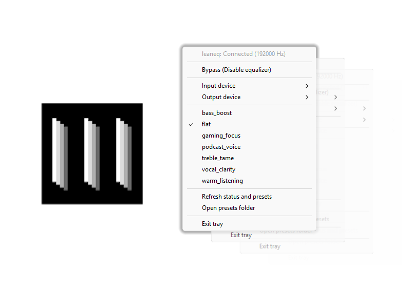

# leaneq
leaneq is an equalizer program that's lightweight (and lives in your tray)

the program only takes up 2-4 MB of RAM :)
[check here](https://postimg.cc/v4BJbk2g)

on supported windows versions, the tray menu follows the system light/dark theme.

## download

1. download it from releases buddy
2. get a virtual audio device, for example [VB-CABLE](https://vb-audio.com/Cable/index.htm)
3. select the virtual audio device as input

should work :)

## audio routing

leaneq processes audio from the selected input device and sends the equalized output to the selected output device. wasapi process loopback is disabled because it adds a delayed copy instead of replacing the original playback.

to equalize windows system playback without doubling it, route playback through a virtual audio cable, pick its capture endpoint from the input device menu, and choose your speakers or headphones as the output.

## presets

bundled presets include flat, bass boost, vocal clarity, podcast voice, gaming focus, warm listening, and treble tame. they're starting points, so tweak them to suit your headphones and ears. preset files live in the `presets` folder beside the executable.

## license

leaneq is licensed under the GNU General Public License v3.0 only. See [LICENSE](LICENSE).

## what am i working on next

- import presets instead of presets folder
- program autoupdate with new release
- per-application routing?  
